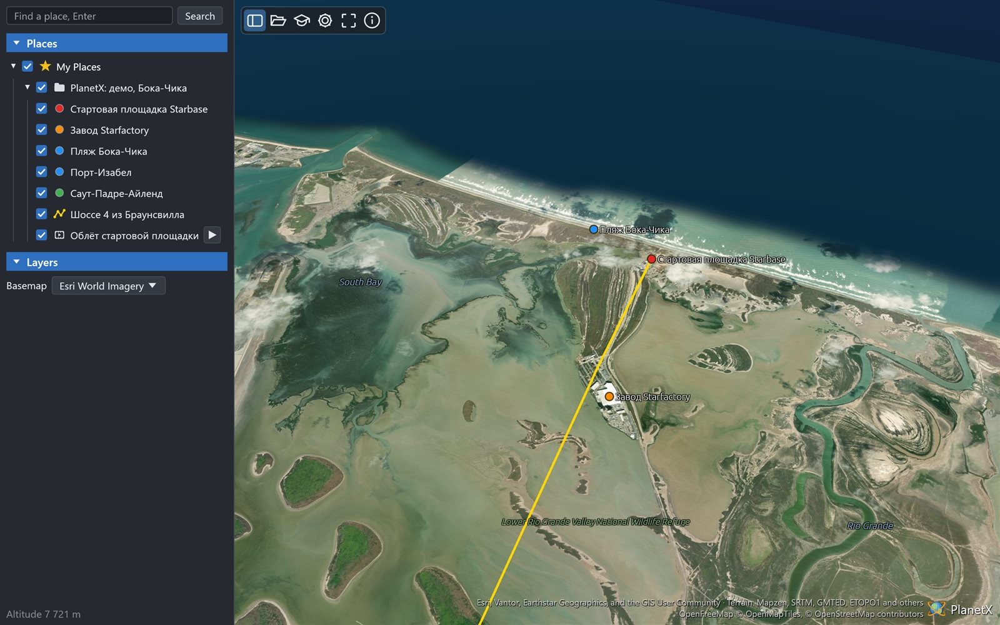

# PlanetX Lite user guide

PlanetX Lite is the [PlanetX](https://github.com/Valery35/planetx) globe
without QGIS: one program for Windows, Linux and macOS and the same
program as a web page, on phones too.

[Русская версия](MANUAL.ru.md)

## Contents

- [Install and start](#install-and-start)
- [Window](#window)
- [Moving around the globe](#moving-around-the-globe)
- [Finding a place](#finding-a-place)
- [Opening files](#opening-files)
- [My Places](#my-places)
- [Layers](#layers)
- [Globe menu](#globe-menu)
- [Drawing and editing](#drawing-and-editing)
- [Ruler](#ruler)
- [Tours and the time slider](#tours-and-the-time-slider)
- [Demo scenes](#demo-scenes)
- [View properties](#view-properties)
- [The web page](#the-web-page)
- [Data sources and privacy](#data-sources-and-privacy)
- [Problems](#problems)

## Install and start

Download a package from the
[releases](https://github.com/Valery35/planetx-lite/releases) page.

| System | Package |
|---|---|
| Windows | `...-windows-x86_64-setup.exe` installs the program for the current user, `...-portable.zip` runs without installation |
| Linux | `...-linux-x86_64.AppImage` - make it executable and run it, `...tar.gz` - unpack and run `planetx-lite` |
| macOS | `...-macos-aarch64.dmg` for Apple Silicon, `...-macos-x86_64.dmg` for Intel - drag PlanetX Lite to Applications |

The files are not signed yet. On Windows the "Windows protected your PC"
window appears: choose "More info" - "Run anyway". On macOS, after the
first attempt to open the program, open System Settings - Privacy &
Security - "Open Anyway".

The web page needs no installation: https://valery35.github.io/planetx-lite/

## Window

The window is laid out as in the PlanetX plugin for QGIS.

- **Left panel.** The search line, the Places section with My Places,
  the Layers section and the status line at the bottom. The first status
  line is the view height and the number of loads in progress, for
  example "View from 20 000 km В· loading 42". The second one is the point
  under the cursor with its height or depth. Program messages take the
  first line for five seconds.
- **Toolbar** in the top left corner of the globe, a spinner turns to its
  right while loading:

| Button | Action |
|---|---|
| Sidebar | Hides or shows the left panel. On a narrow screen the panel starts hidden |
| Identify features | When on, a click on the globe opens the Features window - coordinates, height or depth of the point and the placemarks there |
| Ruler | The Ruler window: length, perimeter and area on the ellipsoid |
| New placemark в–ѕ | Menu Placemark, Path, Polygon, Circle - the New placemark window on that tab |
| Save view | Asks for a name and puts a placemark with the current camera view into the selected folder |
| Record a flight | Records the camera path. A second click ends the recording and asks for the tour name |
| Time slider | Opens and closes the time slider. Available when visible placemarks have time |
| View snapshot | Saves the view to a PNG file |
| Copy the view | Puts the view to the clipboard - the globe with labels, without the toolbar, the navigation controls and the time slider |
| Scene ▾ | Save Scene…, Open Scene…, Share View… - a link to the view. On a phone the system Share window opens |
| Demo в–ѕ | Prepared scenes by topic |
| View properties | The View properties window |
| Full screen | Full screen, F11. The panels hide, the navigation controls and the time slider stay. Esc or F11 returns the window |
| About | Version, the user guide, links |

- **Navigation controls** in the top right corner of the globe, see
  Moving around the globe.
- **Source credits** in the bottom right corner. A click opens the Data
  sources window with full credits and links. A click on the PlanetX
  mark opens About.
## Moving around the globe

The controls follow Google Earth.

| Action | Mouse | Keys |
|---|---|---|
| Turn the globe | Drag with the left button, a throw keeps it turning | Arrows |
| Zoom | Wheel, right button drag, double click to fly closer, double right click to fly away | Page Up, Page Down, plus, minus |
| Tilt and rotate | Middle button or Shift with the left button | Shift with arrows |
| Look around | Ctrl and Shift with the left button | Ctrl with arrows |
| Shift the view along the screen | Ctrl with the left button | |
| North up, look straight down, both | | N, U, R |
| Stop | | Space |

On a phone: one finger turns the globe, a pinch zooms to the middle of
the pinch, turning two fingers rotates, two fingers up and down tilt.

**Navigation controls** stand in the top right corner, as in Google
Earth. While the cursor is far away they show as a faint outline.

- Dragging the ring rotates the view. A click on the letter N puts north
  up.
- The stick inside the ring turns the gaze, the dot in its middle
  returns a straight down view.
- The lower stick moves the view, faster further from the middle.
- The slider sets the height, plus and minus zoom while held.

## Finding a place

Type a name, coordinates or an action in the line at the top of the
panel and press Enter or Search. The camera flies to the place, a mark
shows it. With several results the list appears under the line. The
search uses Nominatim OpenStreetMap.

While typing, a list of hints appears under the line: "name - placemark"
from My Places, program actions like "Ruler - open the window" or "Grid -
turn on", and "query - earlier query". Other words find the actions too:
"measure" finds the ruler, "screenshot" the snapshot. A click on a hint
runs it. Enter with the exact name of a hint runs it, otherwise searches
for a place. Ctrl+K puts the cursor into the search line.
## Opening files

Open Scene… in the Scene menu, Open KML or KMZ… in the My Places menu, a
file dropped onto the window, or file names on the
command line open:

| File | What appears |
|---|---|
| `.planetx` | A PlanetX scene: camera, placemarks, tours, overlays |
| `.kml`, `.kmz` | Placemarks, paths, polygons, overlays, tours, 3D models |
| `.gpkg` | GeoPackage layers as placemarks |
| `.tif`, `.tiff` | A GeoTIFF or COG elevation raster cut into the globe terrain |
| `.las`, `.laz` | A point cloud, COPC included, in the colours of the file |
| `.csv` | Points, read by a sandboxed WebAssembly add-in |

Several files open in order: an elevation raster first, then the scene
over it.

## My Places

Every opened scene or file becomes a folder in My Places. The tree keeps
its content between runs.

- A checkbox shows or hides a row and everything in it.
- A double click flies to the row.
- A click on a placemark on the globe opens its card: description, links
  and fields. The card buttons fly to it and open Properties.
- Ctrl+C copies the selected row as KML, Ctrl+V pastes KML from the
  clipboard into the selected folder.
- A click selects the row. Delete removes it after a question, F2
  renames it.
- Drag a row onto a folder to put it inside, onto another row to put it
  before that row, onto My Places to put it at the end.

Under the tree there is an opacity slider and the в–¶ button. The slider
changes the opacity of the selected placemarks, paths, polygons, pictures
and folder contents, the value is kept in KML. The в–¶ button plays a tour:
for My Places and a folder over the checked placemarks, for a path along
the path, for a placemark over its folder.

The right button opens the menu, as in the plugin:

| Row | Menu |
|---|---|
| Folder | Fly to, Add ▸, Cut, Copy, Paste, Delete, Open KML or KMZ…, Save as KML…, Snapshot folder view, Sort A-Z, Play tour, Properties… |
| Placemark, path, overlay | Fly to, Play tour (for a recorded tour), Tour along the path and Elevation profile (for a path), Snapshot view, Properties…, New Folder, Cut, Copy, Paste, Delete |
| My Places | Add ▸, Play tour, Sort A-Z, Open KML or KMZ…, Save as KML…, Copy, Paste, Clear My Places… |

Add в–ё adds a folder, a placemark, a path, a polygon or a recorded tour.
Snapshot view sets the current camera view to the row. Properties… of a
folder: name, expanding, radio group, Hide beyond, description and the
folder view.

**Saving.** "Save as KML…" writes the row to KML, or to KMZ when it
contains pictures or models. "Save Scene…" in the Scene menu writes a
`.planetx` scene with the current camera and the selected folder. The
PlanetX plugin for QGIS opens these scenes too. On the web page the file
is downloaded.

## Layers

The Layers section shows everything on the globe:

- the Add data button - the catalog: base maps, the vector base and the
  grid, the atmosphere and the sun;
- "Base map В· name" - a click opens the choice of the basemap;
- "Terrain В· Terrarium" - the checkbox turns the terrain on, a click on
  the name opens the terrain menu;
- layers of the catalog that are on: Atmosphere, Sun, Grid. The checkbox
  turns a layer off, the row stays until "Remove from the globe" in the
  "в‹Ї" menu;
- groups of the OpenFreeMap vector base: Borders and names (borders,
  settlements, water names), Transport (roads, road numbers, railways,
  airports), Nature (rivers, lakes and reservoirs, peaks, reserves and
  national parks). Lines lie over the imagery as in the plugin:
  countries yellow, regions white, motorways yellow, railways light with
  a dark dash, rivers blue. Borders and settlements are on by default.

## Globe menu

A right click without dragging opens the menu:

- the coordinates of the point - a click copies them;
- while drawing - Delete vertex, Finish drawing or Continue drawing,
  Save, Clear;
- over a placemark - its name and Properties…;
- Add placemark, Measure distance, Fly to, Orbit around, Point
  details. Point details opens the Features window with the address of the
  point from Nominatim and its height.

Temporary Places stand as a row of their own under My Places. The row
is selected at start, so new placemarks, paths and measurements go
there. New items go into the selected folder, next to a selected
placemark. The menu of the row moves the contents to My Places or
clears them. When the program closes with items in the folder, it asks:
Save, Don't save or Cancel. A placemark to keep at once is dragged to
My Places. Ctrl and Shift select several rows, the menu and dragging
act on all of them.

The placemark menu works with the subsurface model. Model section… of
a path opens a section window in metres: terrain, beds, drill holes and
tunnels from a band along the line, lines and polygons with Z from the
model file. The checkboxes on the left choose
the layers, the right button on the chart sets a color, the section is
saved as a picture and a CSV table. Model section wall puts a wall along
the path on the globe, Model cut cuts the model by a polygon. Choosing
the item again removes them.

## Drawing and editing

The New placemark button opens a window with tabs Placemark, Path,
Polygon and Circle.

- A click on the globe adds a point, dragging the globe still moves it.
- A vertex is dragged with the mouse.
- A click on the last point finishes a path, a click on the first one
  closes the shape into a polygon.
- After drawing, a small circle in the middle of a segment adds a vertex.
- Backspace or Delete removes the last point.
- Name, colour, width and fill are set in the window. Save puts the
  object into the selected folder of My Places.

"Properties…" in the menu of a placemark opens the same window for an
existing placemark: name, description, colour, width, fill and its
vertices on the globe. "New folder" adds a folder.

## Ruler

The Ruler button opens a window with tabs Line, Path, Polygon and Circle.
Points are placed and dragged as in drawing.

| Tab | Values |
|---|---|
| Line | Map length, ground length, heading |
| Path | Map length, ground length |
| Polygon | Perimeter, area |
| Circle | Radius, perimeter, area |

Lengths and areas are measured on the WGS84 ellipsoid. Ground length
follows the terrain, "≈" means terrain tiles are still loading. Units
are chosen next to each value. Save asks for a name, "Line 1", "Path 1"
or similar, and puts the shape into My Places with the measurement in
its description.

**Elevation profile.** The Elevation profile button of the ruler for a
line or a path, and the path menu item, open a window with a height
chart. It shows the map and ground length, the lowest and highest
height, gain, loss and slope. The cursor over the chart puts a red dot
on the globe. For the ruler the profile follows its points.

**Save view.** The folder menu item puts a placemark with the current
camera view into the folder. A double click on it returns to this view.

## Tours and the time slider

The play button next to a recorded tour starts it, "Play tour" in a
folder menu flies over the folder's placemarks. During a tour the panel
on top shows pause and stop. Dragging the globe stops the tour.

Placemarks with dates turn on the Time slider button of the toolbar. The
time slider under the toolbar shows the placemarks of the chosen period.
Its buttons go to the start, play, go to the end and play in a loop. The
speed is a multiple of real time from ×1 to ×86400, or the whole slider
in 20 s. 3D models on a `gx:Track` drive along it at the moment of the
right handle, with the slider closed they stand at the end of the path.
Animated glTF and Collada models play on their own.

**Recording a tour.** The Record a flight button starts recording,
the camera moves as usual meanwhile. A second click ends it and asks for
a name, "Tour 1". The tour
goes to My Places as a path with a tour, the play button replays it.

## Demo scenes

The Demo button opens scenes of the PlanetX plugin from the
[planetx-terrain](https://github.com/Valery35/planetx-terrain)
repository: placemarks and tours, imagery and maps, the Japan Trench and
the Vegas Loop tunnels, own terrain of a quarry and the bed of Lake
Brienz, 3D models, haul trucks in open pits. The program downloads the
demo files once and keeps them, the web page relies on the browser
cache.

## View properties

The View properties window - the gear button, as in the plugin:

| Group | What it sets |
|---|---|
| Base map | The basemap and the Data sources… button |
| Terrain | Vertical exaggeration from 0.5 to 10 |
| Labels | Language of names on the globe: as the interface, local names or a chosen language |
| Coordinates | Format: decimal degrees, degrees-minutes-seconds, UTM, MGRS |
| Appearance | Light or dark, the interface language - as in the system or one of 16 languages |
Properties are kept between runs. `PLANETX_LANGUAGE=de` sets the language
for one run of the program.

## The web page

https://valery35.github.io/planetx-lite/ works in Chrome, Edge, Firefox
and Safari, on phones too.

- `?scene=address` opens a scene, KML or KMZ by a link. Several
  `scene` parameters open in order.
- `?pose=latitude,longitude,distance,heading,tilt` sets the camera.
- My Places are kept in the browser, up to about 4 MB.
- Chinese, Japanese and Korean download a font once, 1-3 MB.

## Data sources and privacy

The globe shows Esri World Imagery, OpenStreetMap, OpenFreeMap labels and
Mapzen Terrain Tiles. Their credits are on the screen, full terms are in
the Data sources window.

The program does not collect or send user information. It requests only
the data it shows, the place search and the demo files. User files stay
on the user's computer.

## Problems

- **The globe is not drawn.** The graphics card has to support Vulkan,
  DirectX 12, Metal or OpenGL. On the web page a current browser is
  needed.
- **Tiles load slowly.** The status line shows the number of requests in
  progress. Tiles are cached: the program keeps them on disk, the web
  page in the browser cache.
- **On Linux the program closes with "Io error: Broken pipe" or
  "Connection reset by peer".** The Wayland compositor disconnects a
  window busy with long work. Versions after 0.1.0 open the window
  through X11 (XWayland) when it is available. For version 0.1.0 start
  it without Wayland: `env -u WAYLAND_DISPLAY ./PlanetX-Lite-...AppImage`.
  `PLANETX_WAYLAND=1` brings Wayland back.

Problems and wishes: https://github.com/Valery35/planetx-lite/issues
