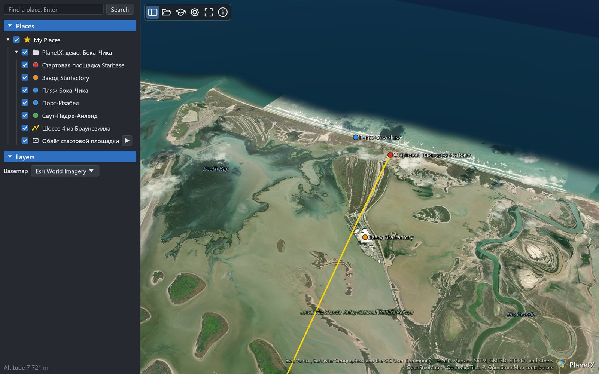

# PlanetX Lite user guide

PlanetX Lite is the [PlanetX](https://github.com/Valery35/planetx) globe
without QGIS: one program for Windows, Linux and macOS and the same
program as a web page, on phones too.

[Русская версия](MANUAL.ru.md)

## Contents

- [Install and start](#install-and-start)
- [Window](#window)
- [Moving around the globe](#moving-around-the-globe)
- [Finding a place](#finding-a-place)
- [Opening files](#opening-files)
- [My Places](#my-places)
- [Layers](#layers)
- [Globe menu](#globe-menu)
- [Recognition](#recognition)
- [Tracing and object extraction](#tracing-and-object-extraction)
- [Drawing and editing](#drawing-and-editing)
- [Ruler](#ruler)
- [Tours and the time slider](#tours-and-the-time-slider)
- [Demo scenes](#demo-scenes)
- [View properties](#view-properties)
- [The web page](#the-web-page)
- [Data sources and privacy](#data-sources-and-privacy)
- [Problems](#problems)

## Install and start

Download a package from the
[releases](https://github.com/Valery35/planetx-lite/releases) page.

| System | Package |
|---|---|
| Windows | `...-windows-x86_64-setup.exe` installs the program for the current user, `...-portable.zip` runs without installation |
| Linux | `...-linux-x86_64.AppImage` - make it executable and run it, `...tar.gz` - unpack and run `planetx-lite` |
| macOS | `...-macos-aarch64.dmg` for Apple Silicon, `...-macos-x86_64.dmg` for Intel - drag PlanetX Lite to Applications |

The files are not signed yet. On Windows the "Windows protected your PC"
window appears: choose "More info" - "Run anyway". On macOS, after the
first attempt to open the program, open System Settings - Privacy &
Security - "Open Anyway".

The web page needs no installation: https://valery35.github.io/planetx-lite/

## Window

The window is laid out as in the PlanetX plugin for QGIS.

- **Left panel.** The search line, the Places section with My Places,
  the Layers section and the status line at the bottom. The first status
  line is the view height and the number of loads in progress, for
  example "View from 20 000 km · loading 42". The second one is the point
  under the cursor with its height or depth. Program messages take the
  first line for five seconds.
- **Toolbar** in the top left corner of the globe, a spinner turns to its
  right while loading:

| Button | Action |
|---|---|
| Sidebar | Hides or shows the left panel. On a narrow screen the panel starts hidden |
| Identify features | When on, a click on the globe opens the Features window - coordinates, height or depth of the point and the placemarks there |
| Ruler | The Ruler window: length, perimeter and area on the ellipsoid |
| New placemark ▾ | Menu Placemark, Path, Polygon, Circle - the New placemark window on that tab |
| Save view | Asks for a name and puts a placemark with the current camera view into the selected folder |
| Record a flight | Records the camera path. A second click ends the recording and asks for the tour name |
| Time slider | Opens and closes the time slider. Available when visible placemarks have time |
| View snapshot | Saves the view to a PNG file |
| Copy the view | Puts the view to the clipboard - the globe with labels, without the toolbar, the navigation controls and the time slider |
| Scene ▾ | Save Scene…, Open Scene…, Share View… - a link to the view. On a phone the system Share window opens |
| Demo ▾ | Prepared scenes by topic |
| View properties | The View properties window |
| Full screen | Full screen, F11. The panels hide, the navigation controls and the time slider stay. Esc or F11 returns the window |
| About | Version, the user guide, links |

- **Navigation controls** in the top right corner of the globe, see
  Moving around the globe.
- **Source credits** in the bottom right corner. A click opens the Data
  sources window with full credits and links. A click on the PlanetX
  mark opens About.
## Moving around the globe

The controls follow Google Earth.

| Action | Mouse | Keys |
|---|---|---|
| Turn the globe | Drag with the left button, a throw keeps it turning | Arrows |
| Zoom | Wheel, right button drag, double click to fly closer, double right click to fly away | Page Up, Page Down, plus, minus |
| Tilt and rotate | Middle button or Shift with the left button | Shift with arrows |
| Look around | Ctrl and Shift with the left button | Ctrl with arrows |
| Shift the view along the screen | Ctrl with the left button | |
| North up, look straight down, both | | N, U, R |
| Stop | | Space |

On a phone: one finger turns the globe, a pinch zooms to the middle of
the pinch, turning two fingers rotates, two fingers up and down tilt.

**Navigation controls** stand in the top right corner, as in Google
Earth. While the cursor is far away they show as a faint outline.

- Dragging the ring rotates the view. A click on the letter N puts north
  up.
- The stick inside the ring turns the gaze, the dot in its middle
  returns a straight down view.
- The lower stick moves the view, faster further from the middle.
- The slider sets the height, plus and minus zoom while held.

## Finding a place

Type a name, coordinates or an action in the line at the top of the
panel and press Enter or Search. The camera flies to the place, a mark
shows it. With several results the list appears under the line. The
search uses Nominatim OpenStreetMap.

While typing, a list of hints appears under the line: "name - placemark"
from My Places, program actions like "Ruler - open the window" or "Grid -
turn on", and "query - earlier query". Other words find the actions too:
"measure" finds the ruler, "screenshot" the snapshot. A click on a hint
runs it. Enter with the exact name of a hint runs it, otherwise searches
for a place. Ctrl+K puts the cursor into the search line.
## Opening files

Open Scene… in the Scene menu, Open KML or KMZ… in the My Places menu, a
file dropped onto the window, or file names on the
command line open:

| File | What appears |
|---|---|
| `.planetx` | A PlanetX scene: camera, placemarks, tours, overlays |
| `.kml`, `.kmz` | Placemarks, paths, polygons, overlays, tours, 3D models |
| `.gpkg`, `.shp`, `.geojson`, `.gpx`, `.topojson`, `.gml`, `.mif`, `.tab`, `.fgb`, `.dxf`, `.dwg`, `.zip` | Layers in the Layers section, see [File layers](#file-layers) |
| `.tif`, `.tiff` | A GeoTIFF or COG elevation raster cut into the globe terrain |
| `.las`, `.laz` | A point cloud, COPC included, in the colours of the file |
| `.csv` | Points, read by a sandboxed WebAssembly add-in |

Several files open in order: an elevation raster first, then the scene
over it.

## My Places

Every opened scene or file becomes a folder in My Places. The tree keeps
its content between runs.

- A checkbox shows or hides a row and everything in it.
- A double click flies to the row.
- A click on a placemark on the globe opens its card: description, links
  and fields. The card buttons fly to it and open Properties.
- Ctrl+C copies the selected row as KML, Ctrl+V pastes KML from the
  clipboard into the selected folder.
- A click selects the row. Delete removes it after a question, F2
  renames it.
- Drag a row onto a folder to put it inside, onto another row to put it
  before that row, onto My Places to put it at the end.

Under the tree there is an opacity slider and the ▶ button. The slider
changes the opacity of the selected placemarks, paths, polygons, pictures
and folder contents, the value is kept in KML. The ▶ button plays a tour:
for My Places and a folder over the checked placemarks, for a path along
the path, for a placemark over its folder.

The right button opens the menu, as in the plugin:

| Row | Menu |
|---|---|
| Folder | Fly to, Add ▸, Cut, Copy, Paste, Delete, Open KML or KMZ…, Save as KML…, Snapshot folder view, Sort A-Z, Play tour, Properties… |
| Placemark, path, overlay | Fly to, Play tour (for a recorded tour), Tour along the path and Elevation profile (for a path), Snapshot view, Properties…, New Folder, Cut, Copy, Paste, Delete |
| My Places | Add ▸, Play tour, Sort A-Z, Open KML or KMZ…, Save as KML…, Copy, Paste, Clear My Places… |

Add ▸ adds a folder, a placemark, a path, a polygon or a recorded tour.
Snapshot view sets the current camera view to the row. Properties… of a
folder: name, expanding, radio group, Hide beyond, description and the
folder view.

**Saving.** "Save as KML…" writes the row to KML, or to KMZ when it
contains pictures or models. "Save Scene…" in the Scene menu writes a
`.planetx` scene with the current camera and the selected folder. The
PlanetX plugin for QGIS opens these scenes too. On the web page the file
is downloaded.

## Layers

The Layers section shows everything on the globe:

- the Add data button - the catalog: base maps, the vector base and the
  grid, the atmosphere and the sun;
- "Base map · name" - a click opens the choice of the basemap;
- "Terrain · Terrarium" - the checkbox turns the terrain on, a click on
  the name opens the terrain menu;
- layers of the catalog that are on: Atmosphere, Sun, Grid. The checkbox
  turns a layer off, the row stays until "Remove from the globe" in the
  "⋯" menu;
- groups of the OpenFreeMap vector base: Borders and names (borders,
  settlements, water names), Transport (roads, road numbers, railways,
  airports), Nature (rivers, lakes and reservoirs, peaks, reserves and
  national parks). Lines lie over the imagery as in the plugin:
  countries yellow, regions white, motorways yellow, railways light with
  a dark dash, rivers blue. Borders and settlements are on by default.

### My layers

A vector file becomes rows of My layers at the top of the Layers section, like the
QGIS project layers in the plugin. One row is one layer of the file. The
program reads GeoPackage, Shapefile, GeoJSON, GPX, TopoJSON, GML,
MapInfo (MIF and TAB), FlatGeobuf, DXF and DWG, and a ZIP archive with a
shapefile. KML, KMZ and scenes still go to My Places.

- A shapefile is several files. In the program the `.dbf`, `.prj` and
  `.cpg` files are taken from the folder of the `.shp`. On the web page
  they are chosen or dropped together with the `.shp`.
- A layer in another coordinate system is converted to WGS84. A layer
  without a coordinate system is read in degrees. A DXF drawing in
  metres without a coordinate system does not open, the program says so.
- Lines and polygons lie over the imagery, points are circles on the
  terrain. A new layer takes the next of eight colours.

The checkbox of a row hides the layer. The "⋯" menu of a row:

| Item | What it does |
|---|---|
| Zoom to layer | Flight to the extent of the layer |
| Colour, line width, fill, point size, opacity | The style of the layer |
| Labels ▸ | A field whose value labels the objects. A layer shows at most 500 labels nearest to the view point |
| Extrusion ▸ and factor | Objects rise to the height from a numeric field: a polygon as a prism, a point as a column, a line as a wall |
| Folder ▸ | The layer moves to a folder of the list, to a new folder by name or out of folders |
| Up, Down | The order of layers: the upper row is drawn on top |
| Copy to My Places | The objects of the layer become placemarks of a folder. They can be edited, measured and saved into a scene |
| Save as GeoJSON… | The objects of the layer with all fields go to a GeoJSON file in WGS84 |
| Remove from the globe | The layer leaves the section |

Folders of one level gather layers. The checkbox of a folder row shows or
hides all its layers, a click on the name folds the folder. The "⋯" menu
of a folder removes all its layers from the globe.

A click of Identify features on an object of a layer shows its fields in
the Features window. My layers stay between launches, like My Places. In
the program the objects of the layers are GeoJSON files in the data
folder of the program, the source file is not needed after opening. The
web page keeps the layers in the browser while together they are under
1 MB. Layers are not written into a scene, like the QGIS project layers
of the plugin. A layer with a time field opens as tracks, a subsurface
model file opens the Subsurface mode window.

## Globe menu

A right click without dragging opens the menu:

- the coordinates of the point - a click copies them;
- while drawing - Delete vertex, Finish drawing or Continue drawing,
  Save, Clear;
- over a placemark - its name and Properties…;
- Add placemark, Measure distance, Fly to, Orbit around, Point
  details. Point details opens the Features window with the address of the
  point from Nominatim and its height.

Temporary Places stand as a row of their own under My Places. The row
is selected at start, so new placemarks, paths and measurements go
there. New items go into the selected folder, next to a selected
placemark. The menu of the row moves the contents to My Places or
clears them. When the program closes with items in the folder, it asks:
Save, Don't save or Cancel. A placemark to keep at once is dragged to
My Places. Ctrl and Shift select several rows, the menu and dragging
act on all of them.

The placemark menu works with the subsurface model. Model section… of
a path opens a section window in metres: terrain, beds, drill holes and
tunnels from a band along the line, lines and polygons with Z from the
model file. The checkboxes on the left choose
the layers, the right button on the chart sets a color, the section is
saved as a picture and a CSV table. Model section wall puts a wall along
the path on the globe, Model cut cuts the model by a polygon. Choosing
the item again removes them.

## Recognition

The «Recognition…» item of the «Area analysis» submenu of the globe menu
opens the «Recognition» window for the clicked point. Since version 0.23
it is one window instead of five, as in the PlanetX plugin 1.40. The
former «Classification», «Object extraction», «Tracing» and «Similar
areas» became tasks of the «Task» list of this window, they have no menu
items of their own.

| Task | What it does |
|---|---|
| Own samples | Classes by points and outlines. The source - Sentinel-2 images of the area, the globe basemap, an opened raster or AlphaEarth |
| Image colours | The image is split into colours, as in the former «Tracing» |
| Similar to the sample | A sample is outlined, the window finds similar objects, as in the former «Similar areas» |
| Forests and clearcuts, Fields, Water | Classes by the rules of the task from the summer and snow images |
| Overgrown fields | A series of spring and autumn images of 4 years, as in the former «Object extraction» |

A change of the task rebuilds the window, the area stays. Below is the
way of own samples by the images of the area: you set the area, add
classes and place their samples, and the window finds the images itself.

Step by step:
1. Area - a square at the point, «Draw» or «From places», up to 20 km.
2. Classes - a name and a colour, the circle picks a class.
3. Samples - points or areas. With «Points» a click on the globe places
   a point of the class, a click on a point removes it, three points
   per class are needed. With «Areas» a click starts an outline of the
   class, a click on the first vertex closes it, a click inside the
   outline removes it. One outline per class is enough, the class
   samples are the cells inside the outline. Points and outlines of one
   class work together.
4. «Build» first checks the area and the samples, then picks the images
   and only after that computes the classes. At least two classes are
   needed.

The «Images» table shows what the window takes - a summer image and
a March - April image with snow. Each is the clearest Sentinel-2 image
over the area in three years, the «Agriculture» combination (B11 B8 B2)
cut to the area. A loaded image becomes a raster of the program. A
raster of the program with band labels and a day of the right month in
its name is taken without loading, so the second «Build» starts at
once. If such a raster does not cover the whole area, the result line
names the share of the area. On snow conifers are dark, bare broadleaf
forest and fields are light, so the snow image helps to tell conifers
from broadleaf. If there is no clear snow image or it does not lie on
the area, the classes are computed from the summer one. A click on the
name of a table row gives other dates, an opened raster or «No image».

The «Task» list chooses where the classes come from. «Own samples» -
classes and samples are set by hand, as above. «Forests and clearcuts»,
«Fields» and «Water» set up their classes themselves and compute them by
the rules of «Object extraction» from the same summer and snow images,
no samples are needed. If a class lies wrong, put its sample as a point
or an outline, and «Build» computes again with it. Each rule class then
gets up to 60 of its own cells as samples, and the samples of the user
are added to them. An own class without a task kind gets cells only by
its own samples. Buildings look like soil by reflectance, among conifers
like clearcuts, an own class with a sample corrects them. «Overgrown
fields» is not in the list - it needs a series of images of 4 years.
«No image» of a table row holds until another image is chosen.

Picking and loading two images of a 3 km area takes a few minutes, most
of it is the cloud cover over the area of catalogue scenes.

After «Build» each class gets a «Visible» check. Without it the class is
hidden from the globe and the terrain is seen under it, the result keeps
the class. The «Show on the globe» check removes the whole preview of
the window, the computation stays.

«OK» puts the polygons and lines of the computation into «My layers», in
the folder «Recognition - task HH:MM:SS UTC». The class polygons are
drawn in the colours of their classes. A computation folder goes to «My
places» - the area, a picture of the classes with a GeoTIFF file and the
control points. «Cancel» removes the classes from the globe. Fine
settings - the pixel, splitting into objects - are there for own samples
with a source other than the images of the area.

## Tracing and object extraction

Tracing and object extraction are the «Image colours» and «Overgrown
fields» tasks of the «Recognition» window, below are their details as in
the former windows. Their area is shared with the other analysis windows. It is a square at the clicked point, an own outline or
a polygon of My Places.

### Tracing

The window splits the image of the area into colours and outlines the
areas of one colour with smooth polygons by the Potrace method. The source
is the globe basemap or a raster opened in the program.

Fields of the window:
- «Colours» - how many colours the image is split into, from 2 to 32.
- «Image smoothing» - passes of 3 × 3 smoothing before the split.
- «Smallest area, cells» - a smaller area merges with the neighbour along
  the longest shared border.
- «Corner rounding» - 0 gives a broken line with corners. The larger the
  value, the more corners become arcs.

«Build» shows the colours of the area cells on the globe. The «Classes»
table under the fields lists the colours by share of the area, «Colour 1»
takes the most. The name of a colour can be rewritten, for example
«Conifers». It goes to the scale on the globe and to the name field of the
polygons. The list to the right of the name merges the colour with another.
The areas of both colours become one class with the name and colour of the
one it is merged with.

The «Names from the assistant» button sends the class table to the AI
assistant. It has mean band values with their roles, share of the area,
count and mean size of the areas, the point of the area and the month of
the image. The image and file names are not sent to the model, pressing
the button is consent to send the table. The assistant answers with a name
for each colour, colours with the same name are merged. The assistant is
connected in the «Assistant settings» window.

«OK» puts the polygons into My Places as the folder of the computation.
Each has the fields cls, name, color and area_ha. The folder name carries
the source and the settings of the computation, for example «Tracing image
(colours 8, smoothing 1, areas from 25 cells, rounding 1.00, pixel 10 m)».
The folder description has the source, the settings and the classes with
their share of the area. Neighbouring areas share their border, there are
no gaps and overlaps. With more than 5000 areas «OK» puts a picture of the
colours and a GeoTIFF file of their numbers.

The «Classes from tracing» button of the «Classification» window takes the
classes of the «Tracing» or «Object extraction» window with their names
and colours. Classes without points are replaced, the points are put by
clicks on the globe.

### Object extraction

The window solves typical tasks over tracing. The colours get names by the
reflectance of the image - coniferous forest, broadleaf forest and grass,
open soil, water, snow. Colours of one kind merge into one class, open soil
among conifers becomes clearcuts.

Step by step:
1. Right-click a place on the globe, «Area analysis» submenu - «Object
   extraction…».
2. Choose the task - «Forests and clearcuts», «Fields», «Water» or
   «Overgrown fields».
3. Set the area.
4. If the «Image» list is empty, press «Find an image». The window finds
   summer Sentinel-2 images of the area for three years without clouds over
   the area. A double click on an image loads it, the image goes to the list
   itself.
5. Press «Build». The classes appear on the globe, the result line names
   the area of clearcuts and the length of lines.
6. Correct the names in the «Classes» table and press «OK».

The «Image» list has only images in which the window recognised the near
infrared and the red or SWIR 1.6 µm by the band labels. The image of the
«Find an image» button is the composite «Agriculture» (B11 B8 B2) for the
area, reflectance, a GeoTIFF file with band labels. It becomes a raster of
the program and serves other analysis windows. The line under the list
tells which bands the window recognised and the day of the image. If the
image covers less than 90 % of the area, «Build» refuses - the classes
would cover only part of the area.

Tasks:
- «Forests and clearcuts» - coniferous forest, broadleaf forest and grass,
  clearcuts and burns, open soil, water.
- «Fields» - vegetation, open soil and ploughland, clearcuts, water.
- «Water» - water and land.
- «Overgrown fields» - ploughland, fields abandoned 1-2 years ago, fallow
  and meadows, overgrowing with trees, forest.

Second image. In summer conifers and broadleaves may have the same near
infrared brightness. A winter - summer pair separates them most easily. On
snow conifers stay dark, bare broadleaf forest and fields are light. The
«Find» button of the «Second image» list searches for images of March and
April while snow lies and of October without snow. The bands of the second
image go to the same grid and are split into colours together with the
first. With snow on the second image, conifers are vegetation that is dark
on snow and not light in the summer near infrared. Without snow, conifers
are vegetation whose near infrared hardly changes between the two dates.

The «Linear objects» flag adds centre lines - roads and cutlines, rivers
and canals, shelterbelts. On the globe the lines are shown over the
classes. «OK» puts the «Lines» folder with the fields kind, name and
length_m next to the polygons. A line is a narrow part of soil, water or
vegetation not wider than 40 m, a connected piece shorter than 200 m is
dropped.

The «More» flag shows the fine settings - pixel, colours, smoothing,
smallest area, corner rounding and line width. The task sets them itself.

Rules:
- water - dark in the near infrared and SWIR.
- vegetation - (NIR - red) / (NIR + red) above 0.35, without the red band -
  (NIR - SWIR) / (NIR + SWIR) above 0.05.
- conifers - the part of the vegetation of the image that is dark in the
  near infrared.
- snow and ice - bright in the visible and dark in SWIR.
- the rest - open soil.
- clearcuts and burns - a piece of open soil with at least a quarter of
  thick coniferous forest in a band of three cells around it.

If the result is wrong:
- Conifers and broadleaves are mixed. Take a second image of March or April
  with snow.
- Classes break up or stick together. Change the number of colours and the
  smallest area under «More».
- Clouds and shadows come out as own classes. Take another image.
- Buildings came out as soil or clearcuts. Outline the area without
  villages or correct the class in the table.

The «Refine with points» button over the table opens the «Classification»
window with the same image, area and classes. Here the classes come from
rules, there they are refined with own control points - for example, if
the rules mixed conifers and broadleaves or a class is needed that the
task does not have. The «Classification…» and «Object extraction…» items
stand next to each other in the submenu.

#### Overgrown fields

The task finds fields that are no longer tilled. Ploughland in spring
before sprouting and in autumn after harvest is bare soil. Fallow has old
grass in spring and autumn, after several years shrubs and young forest.
The window looks at a series of spring and autumn images for 4 years. For
each field of the summer image it finds the year when the field was bare
soil for the last time.

Step by step:
1. Choose the «Overgrown fields» task and a summer image.
2. Press «Pick images» in the «Spring and autumn» row. The window searches
   for Sentinel-2 images of the area for 4 years and takes the image with
   the least cloud cover over the area into each empty cell of the table.
   With equal cloud cover the image closer to the end of May in spring and
   to the beginning of October in autumn is taken. The images are loaded in
   turn as the composite «SWIR» (B12 B8A B4).
3. The table has years as rows and «Spring» and «Autumn» as columns, the
   cell shows the day of the image. A click on a cell gives other days of
   the season and «No image».
4. Press «Build», then «OK».

Classes:
- «Ploughland, tilled» - bare soil in the last year of the series.
- «Abandoned 1-2 years» - the last bare soil one or two years ago.
- «Fallow or meadow» - no bare soil for three years or more, trees on less
  than a quarter of the field.
- «Overgrowing with trees» - trees on a quarter of the field or more.
- «Forest» - trees on 70 % of the area or more.

Bare soil is (NIR - red) / (NIR + red) below 0.3 on a spring or autumn
image. Trees are the median SWIR 2.2 µm of the season images below 0.09.
The polygons get the fields last_bare (the year of the last bare soil,
0 - never) and woody_pct (the share of trees in percent). Perennial grass
on hayfields is never bare over the series and comes out as fallow.

## Drawing and editing

The New placemark button opens a window with tabs Placemark, Path,
Polygon and Circle.

- A click on the globe adds a point, dragging the globe still moves it.
- A vertex is dragged with the mouse.
- A click on the last point finishes a path, a click on the first one
  closes the shape into a polygon.
- After drawing, a small circle in the middle of a segment adds a vertex.
- Backspace or Delete removes the last point.
- Name, colour, width and fill are set in the window. Save puts the
  object into the selected folder of My Places.

"Properties…" in the menu of a placemark opens the same window for an
existing placemark: name, description, colour, width, fill and its
vertices on the globe. "New folder" adds a folder.

## Ruler

The Ruler button opens a window with tabs Line, Path, Polygon and Circle.
Points are placed and dragged as in drawing.

| Tab | Values |
|---|---|
| Line | Map length, ground length, heading |
| Path | Map length, ground length |
| Polygon | Perimeter, area |
| Circle | Radius, perimeter, area |

Lengths and areas are measured on the WGS84 ellipsoid. Ground length
follows the terrain, "≈" means terrain tiles are still loading. Units
are chosen next to each value. Save asks for a name, "Line 1", "Path 1"
or similar, and puts the shape into My Places with the measurement in
its description.

**Elevation profile.** The Elevation profile button of the ruler for a
line or a path, and the path menu item, open a window with a height
chart. It shows the map and ground length, the lowest and highest
height, gain, loss and slope. The cursor over the chart puts a red dot
on the globe. For the ruler the profile follows its points.

**Save view.** The folder menu item puts a placemark with the current
camera view into the folder. A double click on it returns to this view.

## Tours and the time slider

The play button next to a recorded tour starts it, "Play tour" in a
folder menu flies over the folder's placemarks. During a tour the panel
on top shows pause and stop. Dragging the globe stops the tour.

Placemarks with dates turn on the Time slider button of the toolbar. The
time slider under the toolbar shows the placemarks of the chosen period.
Its buttons go to the start, play, go to the end and play in a loop. The
speed is a multiple of real time from ×1 to ×86400, or the whole slider
in 20 s. 3D models on a `gx:Track` drive along it at the moment of the
right handle, with the slider closed they stand at the end of the path.
Animated glTF and Collada models play on their own.

**Recording a tour.** The Record a flight button starts recording,
the camera moves as usual meanwhile. A second click ends it and asks for
a name, "Tour 1". The tour
goes to My Places as a path with a tour, the play button replays it.

## Demo scenes

The Demo button opens scenes of the PlanetX plugin from the
[planetx-terrain](https://github.com/Valery35/planetx-terrain)
repository: placemarks and tours, imagery and maps, the Japan Trench and
the Vegas Loop tunnels, own terrain of a quarry and the bed of Lake
Brienz, 3D models, haul trucks in open pits. The program downloads the
demo files once and keeps them, the web page relies on the browser
cache.

## View properties

The View properties window - the gear button, as in the plugin:

| Group | What it sets |
|---|---|
| Base map | The basemap and the Data sources… button |
| Terrain | Vertical exaggeration from 0.5 to 10 |
| Labels | Language of names on the globe: as the interface, local names or a chosen language |
| Coordinates | Format: decimal degrees, degrees-minutes-seconds, UTM, MGRS |
| Appearance | Light or dark, the interface language - as in the system or one of 16 languages |
Properties are kept between runs. `PLANETX_LANGUAGE=de` sets the language
for one run of the program.

## The web page

https://valery35.github.io/planetx-lite/ works in Chrome, Edge, Firefox
and Safari, on phones too.

- `?scene=address` opens a scene, KML or KMZ by a link. Several
  `scene` parameters open in order.
- `?pose=latitude,longitude,distance,heading,tilt` sets the camera.
- My Places are kept in the browser, up to about 4 MB.
- Chinese, Japanese and Korean download a font once, 1-3 MB.

## Data sources and privacy

The globe shows Esri World Imagery, OpenStreetMap, OpenFreeMap labels and
Mapzen Terrain Tiles. Their credits are on the screen, full terms are in
the Data sources window.

The program does not collect or send user information. It requests only
the data it shows, the place search and the demo files. User files stay
on the user's computer.

## Problems

- **The globe is not drawn.** The graphics card has to support Vulkan,
  DirectX 12, Metal or OpenGL. On the web page a current browser is
  needed.
- **Tiles load slowly.** The status line shows the number of requests in
  progress. Tiles are cached: the program keeps them on disk, the web
  page in the browser cache.
- **On Linux the program closes with "Io error: Broken pipe" or
  "Connection reset by peer".** The Wayland compositor disconnects a
  window busy with long work. Versions after 0.1.0 open the window
  through X11 (XWayland) when it is available. For version 0.1.0 start
  it without Wayland: `env -u WAYLAND_DISPLAY ./PlanetX-Lite-...AppImage`.
  `PLANETX_WAYLAND=1` brings Wayland back.

Problems and wishes: https://github.com/Valery35/planetx-lite/issues
