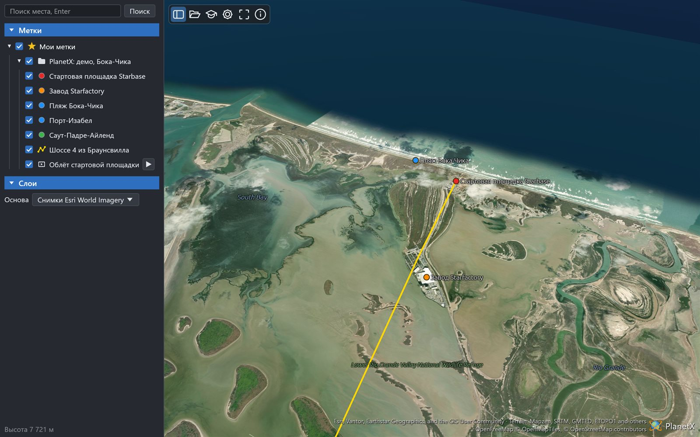

# Руководство PlanetX Lite

PlanetX Lite - глобус [PlanetX](https://github.com/Valery35/planetx)
без QGIS: одна программа для Windows, Linux и macOS и та же программа
страницей в браузере, на телефоне тоже.

[English version](MANUAL.en.md)

## Содержание

- [Установка и запуск](#установка-и-запуск)
- [Окно](#окно)
- [Движение по глобусу](#движение-по-глобусу)
- [Поиск места](#поиск-места)
- [Открытие файлов](#открытие-файлов)
- [Мои метки](#мои-метки)
- [Рисование и правка](#рисование-и-правка)
- [Линейка](#линейка)
- [Туры и шкала времени](#туры-и-шкала-времени)
- [Демо](#демо)
- [Настройки](#настройки)
- [Страница в браузере](#страница-в-браузере)
- [Источники данных и приватность](#источники-данных-и-приватность)
- [Неполадки](#неполадки)

## Установка и запуск

Пакет скачивается на странице
[выпусков](https://github.com/Valery35/planetx-lite/releases).

| Система | Пакет |
|---|---|
| Windows | `...-windows-x86_64-setup.exe` ставит программу текущему пользователю, `...-portable.zip` работает без установки |
| Linux | `...-linux-x86_64.AppImage` - сделать исполняемым и запустить, `...tar.gz` - распаковать и запустить `planetx-lite` |
| macOS | `...-macos-aarch64.dmg` для Apple Silicon, `...-macos-x86_64.dmg` для Intel - перетащить PlanetX Lite в «Программы» |

Файлы пока не подписаны. Windows покажет окно «Система Windows
защитила ваш компьютер»: «Подробнее» - «Выполнить в любом случае».
macOS после первой попытки открыть программу: «Системные настройки» -
«Конфиденциальность и безопасность» - «Всё равно открыть».

Странице установка не нужна: https://valery35.github.io/planetx-lite/

## Окно

- **Левая панель.** Поиск места, раздел «Метки» с «Моими метками»,
  раздел «Слои» с основой и строка состояния внизу: высота взгляда
  и количество идущих запросов.
- **Панель инструментов** в левом верхнем углу глобуса:

| Кнопка | Действие |
|---|---|
| Панель | Показать или скрыть левую панель. На узком экране панель при запуске скрыта |
| Открыть | Открыть сцену, KML, KMZ или файл данных |
| Демо | Меню демо |
| Новая метка | Рисует на глобусе новую метку, путь, многоугольник или круг |
| Линейка | Меряет длину, длину по рельефу, курс, периметр и площадь |
| Запись облёта | Записывает путь камеры, пока глобус движется. Повторное нажатие заканчивает запись, облёт ложится в «Мои метки» |
| Снимок вида | Сохраняет вид в файл PNG. Окна в снимок не попадают, подпись источников попадает |
| Поделиться | Копирует ссылку на вид: камеру и сцены, открытые по адресу или из меню «Демо». На телефоне открывается окно «Поделиться» системы. Файлов, открытых с диска, в ссылке нет |
| Настройки | Окно «Настройки» |
| Во весь экран | Включить и выключить весь экран |
| О программе | Версия, руководство, ссылки |

- **Органы навигации** в правом верхнем углу глобуса, о них -
  в разделе «Движение по глобусу».
- **Подпись источников** в правом нижнем углу. Щелчок открывает окно
  «Источники данных» с полными подписями и ссылками.

## Движение по глобусу

Управление как в Google Earth.

| Действие | Мышь | Клавиши |
|---|---|---|
| Вращать глобус | Перетаскивание левой кнопкой, бросок продолжает вращение | Стрелки |
| Приблизить и отдалить | Колесо, перетаскивание правой кнопкой, двойной щелчок - перелёт ближе, двойной щелчок правой - дальше | Page Up, Page Down, плюс, минус |
| Наклон и поворот | Средняя кнопка или Shift с левой | Shift со стрелками |
| Взгляд по сторонам | Ctrl и Shift с левой | Ctrl со стрелками |
| Сдвиг вида вдоль экрана | Ctrl с левой | |
| Север вверху, взгляд отвесно, то и другое | | N, U, R |
| Остановка | | Пробел |

На телефоне: один палец вращает глобус, щипок приближает к середине
щипка, поворот двух пальцев поворачивает вид, два пальца вверх и вниз
наклоняют.

**Органы навигации** в правом верхнем углу, как в Google Earth. Пока
курсор далеко, они стоят слабым контуром.

- Кольцо тянется мышью и поворачивает вид. Щелчок по букве N ставит
  север вверху.
- Джойстик внутри кольца поворачивает взгляд, точка в его середине
  возвращает отвесный взгляд.
- Нижний джойстик сдвигает вид. Чем дальше от середины, тем быстрее.
- Ползунок задаёт высоту, плюс и минус приближают и отдаляют, пока
  нажаты.

## Поиск места

Название или координаты вводятся в поле вверху панели, Enter или
кнопка «Поиск». Камера летит к месту, красная метка показывает его.
Если найдено несколько мест, их список встаёт под полем. Поиск идёт
через Nominatim OpenStreetMap.

При вводе под полем встают подсказки - метки из «Моих меток», действия
программы и прежние запросы. Действия - инструменты, окна, солнце,
сетка, тема, демо, основы. Их находят и по другим словам: «измерить» -
линейка, «скриншот» - снимок вида. Щелчок по подсказке выполняет её.
Enter с точным названием подсказки выполняет её, иначе ищет место.
Ctrl+K ставит курсор в поле поиска.

## Открытие файлов

Кнопка «Открыть», файл, брошенный в окно, или имена файлов в командной
строке открывают:

| Файл | Что появляется |
|---|---|
| `.planetx` | Сцена PlanetX: камера, метки, туры, наложения |
| `.kml`, `.kmz` | Метки, пути, многоугольники, наложения, туры, 3D-модели |
| `.gpkg` | Слои GeoPackage метками |
| `.tif`, `.tiff` | Растр высот GeoTIFF или COG, врезанный в рельеф глобуса |
| `.las`, `.laz` | Облако точек, в том числе COPC, в цветах файла |
| `.csv` | Точки, их читает аддин WebAssembly в песочнице |

Несколько файлов открываются по порядку: сначала растр высот, потом
сцена над ним.

## Мои метки

Каждая открытая сцена или файл ложится папкой в «Мои метки». Дерево
хранится между запусками.

- Флажок показывает или скрывает строку и всё внутри неё.
- Двойной щелчок - перелёт к строке.
- Щелчок по метке на глобусе открывает её карточку - описание,
  ссылки и поля. Кнопки карточки - перелёт и «Свойства…».
- Ctrl+C копирует выделенную строку как KML, Ctrl+V вставляет KML
  из буфера обмена в выделенную папку.
- Щелчок выделяет строку. Delete удаляет её, F2 переименовывает.
- Строка, брошенная на папку, ложится в неё, брошенная на другую
  строку - перед ней, брошенная на «Мои метки» - в конец.
- Правая кнопка открывает меню:

| Строка | Меню |
|---|---|
| Метка, наложение | Подлететь, Запустить тур (у записанного тура), Профиль высот (у пути), Свойства, Копировать как KML, Сохранить как KML, Сохранить сцену, Переименовать, Удалить |
| Папка | Подлететь, Запустить тур, Сохранить вид, Новая папка, Копировать как KML, Сохранить как KML, Сохранить сцену, Переименовать, Удалить |
| Мои метки | Открыть, Запустить тур, Сохранить как KML, Сохранить сцену, Очистить «Мои метки» |

**Сохранение.** «Сохранить как KML» пишет строку в KML или в KMZ, если
в ней есть картинки или модели. «Сохранить сцену» пишет сцену
`.planetx` с текущей камерой. Такие сцены открывает и модуль PlanetX
для QGIS. На странице файл скачивается.

## Рисование и правка

Кнопка «Новая метка» открывает окно с вкладками «Метка», «Путь»,
«Многоугольник» и «Круг».

- Щелчок по глобусу ставит точку, перетаскивание по-прежнему двигает
  глобус.
- Вершина перетаскивается мышью.
- Щелчок по последней точке завершает путь, по первой - замыкает
  фигуру в многоугольник.
- После рисования кружок в середине отрезка ставит новую вершину.
- Backspace или Delete убирают последнюю точку.
- Название, цвет, толщина и заливка задаются в окне. «Сохранить»
  кладёт объект в выделенную папку «Моих меток».

«Свойства…» в меню метки открывают то же окно для готовой метки:
название, описание, цвет, толщина, заливка и вершины на глобусе.
«Новая папка» добавляет папку.

## Линейка

Кнопка «Линейка» открывает окно с вкладками «Линия», «Путь»,
«Многоугольник» и «Круг». Точки ставятся и тянутся, как при рисовании.

| Вкладка | Величины |
|---|---|
| Линия | Длина на карте, длина по рельефу, курс |
| Путь | Длина на карте, длина по рельефу |
| Многоугольник | Периметр, площадь |
| Круг | Радиус, периметр, площадь |

Длины и площади меряются на эллипсоиде WGS84. Длина по рельефу идёт
по высотам, знак «≈» - тайлы высот ещё грузятся. Единицы выбираются
рядом с каждой величиной. «Сохранить» кладёт фигуру в «Мои метки»
с измерением в описании.

**Профиль высот.** Кнопка «Профиль высот» линейки у линии и пути
и пункт меню пути открывают окно с графиком высот. Окно показывает
длину на карте и по рельефу, наименьшую и наибольшую высоту, подъём,
спуск и уклон. Курсор над графиком ставит красную точку на глобусе.
У линейки профиль следует за её точками.

**Сохранить вид.** Пункт меню папки кладёт в неё метку с текущим видом
камеры. Двойной щелчок по метке возвращает этот вид.

## Туры и шкала времени

Кнопка ▶ у записанного тура запускает его, «Запустить тур» в меню
папки облетает её метки. Во время тура плашка сверху даёт паузу
и остановку. Перетаскивание глобуса останавливает тур.

Метки с датами включают кнопку «Время» в разделе «Метки». Шкала
времени под панелью инструментов показывает метки выбранного
промежутка. Её кнопки - к началу, проигрывание, к концу и по кругу.
Скорость - во сколько раз быстрее часов, от ×1 до ×86400, или вся
шкала за 20 с. 3D-модели на `gx:Track` едут по пути на момент правого
бегунка, при закрытой шкале стоят в конце пути. Модели glTF и Collada
с анимацией двигаются сами.

**Запись облёта.** Кнопка записи на панели инструментов начинает
запись, пока она идёт, камера двигается как обычно. Повторное нажатие
заканчивает запись. Облёт ложится в «Мои метки» путём с туром,
кнопка ▶ проигрывает его.

## Демо

Кнопка «Демо» открывает сцены модуля PlanetX из хранилища
[planetx-terrain](https://github.com/Valery35/planetx-terrain): метки
и туры, снимки и карты, Японский жёлоб и тоннели Vegas Loop, свой
рельеф карьера и дно Бриенцского озера, 3D-модели, самосвалы
в карьерах. Программа скачивает файлы демо один раз и хранит их,
страница полагается на кэш браузера.

## Настройки

| Настройка | Значения |
|---|---|
| Язык интерфейса | Как в системе или один из 16 языков |
| Язык подписей | Язык названий на глобусе: как интерфейс, местные названия или выбранный язык |
| Оформление | Тёмное или светлое |
| Вертикальный масштаб | Множитель высот рельефа от 0,5 до 10 |
| Солнце | Рельеф освещён солнцем на момент шкалы времени или на текущий момент, ночь тёмная |
| Координатная сетка | Параллели и меридианы с подписями, экватор, тропики и полярные круги |

Настройки хранятся между запусками. `PLANETX_LANGUAGE=de` задаёт язык
на один запуск программы.

## Страница в браузере

https://valery35.github.io/planetx-lite/ работает в Chrome, Edge,
Firefox и Safari, на телефоне тоже.

- `?scene=адрес` открывает сцену, KML или KMZ по ссылке. Несколько
  параметров `scene` открываются по порядку.
- `?pose=широта,долгота,расстояние,азимут,наклон` задаёт камеру.
- «Мои метки» хранятся в браузере, до 4 МБ.
- Для китайского, японского и корейского страница один раз скачивает
  шрифт, 1-3 МБ.

## Источники данных и приватность

Глобус показывает снимки Esri World Imagery, карту OpenStreetMap,
подписи OpenFreeMap и рельеф Mapzen Terrain Tiles. Их подписи на
экране, полные условия - в окне «Источники данных».

Программа не собирает и не отправляет сведения о пользователе. Она
запрашивает только то, что показывает, поиск места и файлы демо.
Файлы пользователя остаются на его компьютере.

## Неполадки

- **Глобус не рисуется.** Видеокарте нужна поддержка Vulkan,
  DirectX 12, Metal или OpenGL. Странице нужен современный браузер.
- **Тайлы грузятся медленно.** Строка состояния показывает количество
  идущих запросов. Тайлы кэшируются: программа хранит их на диске,
  страница - в кэше браузера.
- **Программа закрывается на Linux с сообщением «Io error: Broken
  pipe» или «Connection reset by peer».** Так композитор Wayland
  отключает окно, занятое долгой работой. С версии после 0.1.0 окно
  открывается через X11 (XWayland), если он есть. Для версии 0.1.0
  запуск без Wayland - `env -u WAYLAND_DISPLAY ./PlanetX-Lite-...AppImage`.
  `PLANETX_WAYLAND=1` возвращает Wayland.

Ошибки и пожелания: https://github.com/Valery35/planetx-lite/issues
