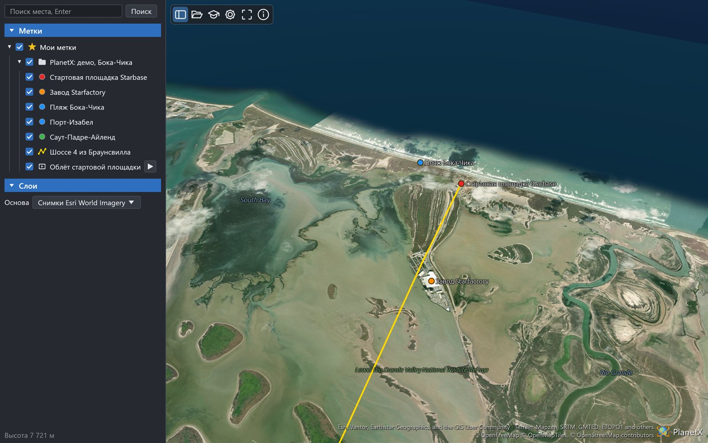

# Руководство PlanetX Lite

PlanetX Lite - глобус [PlanetX](https://github.com/Valery35/planetx)
без QGIS: одна программа для Windows, Linux и macOS и та же программа
страницей в браузере, на телефоне тоже.

[English version](MANUAL.en.md)

## Содержание

- [Установка и запуск](#установка-и-запуск)
- [Окно](#окно)
- [Движение по глобусу](#движение-по-глобусу)
- [Поиск места](#поиск-места)
- [Открытие файлов](#открытие-файлов)
- [Мои метки](#мои-метки)
- [Слои](#слои)
- [Меню на глобусе](#меню-на-глобусе)
- [Распознавание](#распознавание)
- [Трассировка и выделение объектов](#трассировка-и-выделение-объектов)
- [Рисование и правка](#рисование-и-правка)
- [Линейка](#линейка)
- [Туры и шкала времени](#туры-и-шкала-времени)
- [Демо](#демо)
- [Свойства вида](#свойства-вида)
- [Страница в браузере](#страница-в-браузере)
- [Источники данных и приватность](#источники-данных-и-приватность)
- [Неполадки](#неполадки)

## Установка и запуск

Пакет скачивается на странице
[выпусков](https://github.com/Valery35/planetx-lite/releases).

| Система | Пакет |
|---|---|
| Windows | `...-windows-x86_64-setup.exe` ставит программу текущему пользователю, `...-portable.zip` работает без установки |
| Linux | `...-linux-x86_64.AppImage` - сделать исполняемым и запустить, `...tar.gz` - распаковать и запустить `planetx-lite` |
| macOS | `...-macos-aarch64.dmg` для Apple Silicon, `...-macos-x86_64.dmg` для Intel - перетащить PlanetX Lite в «Программы» |

Файлы пока не подписаны. Windows покажет окно «Система Windows
защитила ваш компьютер»: «Подробнее» - «Выполнить в любом случае».
macOS после первой попытки открыть программу: «Системные настройки» -
«Конфиденциальность и безопасность» - «Всё равно открыть».

Странице установка не нужна: https://valery35.github.io/planetx-lite/

## Окно

Окно устроено как у модуля PlanetX для QGIS.

- **Левая панель.** Строка поиска, раздел «Метки» с «Моими метками»,
  раздел «Слои» и строка состояния внизу. Первая строка состояния -
  высота обзора и количество идущих загрузок, например «Обзор с высоты
  20 000 км · загрузка 42». Вторая - точка под курсором и её высота
  или глубина. Сообщения программы встают в первую строку на пять
  секунд.
- **Панель значков** в левом верхнем углу глобуса, справа от неё во
  время загрузки крутится значок:

| Кнопка | Действие |
|---|---|
| Боковая панель | Скрыть или показать левую панель. На узком экране панель при запуске скрыта |
| Определить объекты | Включённая кнопка: щелчок по глобусу открывает окно «Объекты» - координаты, высота или глубина точки и метки под ней |
| Линейка | Окно «Линейка»: длина, периметр и площадь на эллипсоиде |
| Новая метка ▾ | Меню «Метка», «Путь», «Многоугольник», «Круг» - окно «Новая метка» на этой вкладке |
| Сохранить вид | Спрашивает название и кладёт метку с текущим видом камеры в выделенную папку |
| Записать облёт | Записывает путь камеры. Повторное нажатие заканчивает запись и спрашивает название тура |
| Шкала времени | Открывает и закрывает шкалу времени. Доступна, когда у видимых меток есть время |
| Снимок вида | Сохраняет вид в файл PNG |
| Копия вида | Кладёт вид в буфер обмена - глобус с подписями, без панели значков, органов навигации и шкалы времени |
| Сцена ▾ | «Сохранить сцену…», «Открыть сцену…», «Поделиться видом…» - ссылка на вид. На телефоне открывается окно «Поделиться» системы |
| Демо ▾ | Подготовленные сцены по темам |
| Свойства вида | Окно «Свойства вида» |
| Во весь экран | Весь экран, F11. Панели прячутся, органы навигации и шкала времени остаются. Esc или F11 возвращает окно |
| О программе | Версия, руководство, ссылки |

- **Органы навигации** в правом верхнем углу глобуса, о них -
  в разделе «Движение по глобусу».
- **Подпись источников** в правом нижнем углу. Щелчок открывает окно
  «Источники данных» с полными подписями и ссылками. Щелчок по знаку
  PlanetX открывает «О программе».
## Движение по глобусу

Управление как в Google Earth.

| Действие | Мышь | Клавиши |
|---|---|---|
| Вращать глобус | Перетаскивание левой кнопкой, бросок продолжает вращение | Стрелки |
| Приблизить и отдалить | Колесо, перетаскивание правой кнопкой, двойной щелчок - перелёт ближе, двойной щелчок правой - дальше | Page Up, Page Down, плюс, минус |
| Наклон и поворот | Средняя кнопка или Shift с левой | Shift со стрелками |
| Взгляд по сторонам | Ctrl и Shift с левой | Ctrl со стрелками |
| Сдвиг вида вдоль экрана | Ctrl с левой | |
| Север вверху, взгляд отвесно, то и другое | | N, U, R |
| Остановка | | Пробел |

На телефоне: один палец вращает глобус, щипок приближает к середине
щипка, поворот двух пальцев поворачивает вид, два пальца вверх и вниз
наклоняют.

**Органы навигации** в правом верхнем углу, как в Google Earth. Пока
курсор далеко, они стоят слабым контуром.

- Кольцо тянется мышью и поворачивает вид. Щелчок по букве N ставит
  север вверху.
- Джойстик внутри кольца поворачивает взгляд, точка в его середине
  возвращает отвесный взгляд.
- Нижний джойстик сдвигает вид. Чем дальше от середины, тем быстрее.
- Ползунок задаёт высоту, плюс и минус приближают и отдаляют, пока
  нажаты.

## Поиск места

Название, координаты или действие вводятся в строку вверху панели,
Enter или кнопка «Поиск». Камера летит к месту, метка показывает его.
Если найдено несколько мест, их список встаёт под строкой. Поиск идёт
через Nominatim OpenStreetMap.

При вводе под строкой встаёт список подсказок: «название - метка»
из «Моих меток», действия программы вроде «Линейка - открыть окно»
или «Координатная сетка - включить» и «запрос - прежний запрос».
Действия находят и по другим словам: «измерить» - линейка, «скриншот» -
снимок вида. Щелчок по подсказке выполняет её. Enter с точным названием
подсказки выполняет её, иначе ищет место. Ctrl+K ставит курсор
в строку поиска.
## Открытие файлов

«Открыть сцену…» в меню «Сцена», «Открыть KML или KMZ…» в меню «Моих
меток», файл, брошенный в окно, или имена файлов в командной строке
открывают:

| Файл | Что появляется |
|---|---|
| `.planetx` | Сцена PlanetX: камера, метки, туры, наложения |
| `.kml`, `.kmz` | Метки, пути, многоугольники, наложения, туры, 3D-модели |
| `.gpkg`, `.shp`, `.geojson`, `.gpx`, `.topojson`, `.gml`, `.mif`, `.tab`, `.fgb`, `.dxf`, `.dwg`, `.zip` | Слои в разделе «Слои», см. [Слои файлов](#слои-файлов) |
| `.tif`, `.tiff` | Растр высот GeoTIFF или COG, врезанный в рельеф глобуса |
| `.las`, `.laz` | Облако точек, в том числе COPC, в цветах файла |
| `.csv` | Точки, их читает аддин WebAssembly в песочнице |

Несколько файлов открываются по порядку: сначала растр высот, потом
сцена над ним.

## Мои метки

Каждая открытая сцена или файл ложится папкой в «Мои метки». Дерево
хранится между запусками.

- Флажок показывает или скрывает строку и всё внутри неё.
- Двойной щелчок - перелёт к строке.
- Щелчок по метке на глобусе открывает её карточку - описание,
  ссылки и поля. Кнопки карточки - перелёт и «Свойства…».
- Ctrl+C копирует выделенную строку как KML, Ctrl+V вставляет KML
  из буфера обмена в выделенную папку.
- Щелчок выделяет строку. Delete удаляет её после вопроса, F2
  переименовывает.
- Строка, брошенная на папку, ложится в неё, брошенная на другую
  строку - перед ней, брошенная на «Мои метки» - в конец.

Под деревом - ползунок непрозрачности и кнопка ▶. Ползунок меняет
непрозрачность выделенных меток, путей, многоугольников, картинок
и содержимого папок, значение хранится в KML. Кнопка ▶ проводит тур:
у «Моих меток» и папки - по отмеченным меткам, у пути - вдоль пути,
у метки - по её папке.

Правая кнопка открывает меню, как у модуля:

| Строка | Меню |
|---|---|
| Папка | Подлететь, Добавить ▸, Вырезать, Копировать, Вставить, Удалить, Открыть KML или KMZ…, Сохранить как KML…, Снимок вида папки, Сортировать от А до Я, Запустить тур, Свойства… |
| Метка, путь, наложение | Подлететь, Запустить тур (у записанного тура), Тур по пути и Профиль высот (у пути), Снимок вида метки, Свойства…, Новая папка, Вырезать, Копировать, Вставить, Удалить |
| Мои метки | Добавить ▸, Запустить тур, Сортировать от А до Я, Открыть KML или KMZ…, Сохранить как KML…, Копировать, Вставить, Очистить «Мои метки»… |

«Добавить ▸» - папку, метку, путь, многоугольник или записанный тур.
«Снимок вида» ставит строке текущий вид камеры. «Свойства…» папки -
название, раскрытие, группа переключателей, «Скрывать дальше»,
описание и вид папки.

**Сохранение.** «Сохранить как KML…» пишет строку в KML или в KMZ, если
в ней есть картинки или модели. «Сохранить сцену…» в меню «Сцена» пишет
сцену `.planetx` с текущей камерой и выделенной папкой. Такие сцены
открывает и модуль PlanetX для QGIS. На странице файл скачивается.

## Слои

Раздел «Слои» показывает всё, что на глобусе:

- кнопка «Добавить данные» - каталог: подоснова, векторная основа
  и координатная сетка, атмосфера и солнце;
- «Основа · название» - щелчок открывает выбор подложки;
- «Рельеф · Terrarium» - флажок включает рельеф, щелчок по названию -
  меню рельефа;
- включённые слои каталога: «Атмосфера», «Солнце», «Координатная
  сетка». Флажок выключает слой, строка остаётся до «Убрать с глобуса»
  в меню «⋯»;
- группы векторной основы OpenFreeMap: «Границы и названия»
  (границы, населённые пункты, названия водоёмов), «Транспорт»
  (дороги, номера дорог, железные дороги, аэропорты), «Природа»
  (реки, водоёмы, вершины, заповедники и нацпарки). Линии ложатся
  поверх снимка, как у модуля: страны жёлтые, области белые,
  магистрали жёлтые, железные дороги светлые с тёмным пунктиром,
  реки синие. По умолчанию включены границы и населённые пункты.

### Мои слои

Векторный файл ложится строками в «Мои слои» сверху раздела «Слои»,
как слои проекта QGIS у модуля. Одна строка - один слой файла. Читаются
GeoPackage, Shapefile, GeoJSON, GPX, TopoJSON, GML, MapInfo (MIF и TAB),
FlatGeobuf, DXF и DWG, а также архив ZIP с шейпфайлом. KML, KMZ и сцены
по-прежнему ложатся в «Мои метки».

- Шейпфайл - несколько файлов. В программе файлы `.dbf`, `.prj` и `.cpg`
  берутся из папки рядом с `.shp`. На странице их выбирают вместе
  с `.shp` или бросают в окно вместе.
- Слой в другой системе координат пересчитывается в WGS84. Слой без
  системы координат читается в градусах. Чертёж DXF в метрах без
  системы координат не открывается, программа сообщает об этом.
- Линии и многоугольники ложатся на снимок, точки - кругами
  на рельефе. Цвет нового слоя берётся по кругу из восьми.

Флажок строки прячет слой. Меню «⋯» строки:

| Пункт | Что делает |
|---|---|
| Приблизить к слою | Перелёт к охвату слоя |
| Цвет, толщина линии, заливка, размер точки, непрозрачность | Стиль слоя |
| Подписи ▸ | Поле, значение которого подписывает объекты. У слоя видны не больше 500 подписей, ближайших к точке взгляда |
| Выдавливание ▸ и множитель | Объекты поднимаются на высоту из числового поля: многоугольник призмой, точка столбиком, линия стенкой |
| Папка ▸ | Слой переносится в папку списка, в новую папку по имени или из папок |
| Выше, Ниже | Порядок слоёв: верхняя строка рисуется поверх |
| Копия в «Мои метки» | Объекты слоя становятся метками папки. Их можно править, измерять и сохранять в сцену |
| Сохранить как GeoJSON… | Объекты слоя со всеми полями записываются файлом GeoJSON в WGS84 |
| Убрать с глобуса | Слой уходит из раздела |

Папки одного уровня собирают слои. Флажок строки папки показывает или
прячет все её слои, щелчок по названию сворачивает папку. Меню «⋯»
папки убирает с глобуса все её слои.

Щелчок «Определить объекты» по объекту слоя показывает его поля
в окне «Объекты». «Мои слои» сохраняются между запусками, как «Мои
метки». В программе объекты слоёв лежат файлами GeoJSON в папке данных
программы, исходный файл после открытия не нужен. Страница хранит слои
в браузере, пока они вместе меньше 1 МБ. В сцену слои не пишутся, как
слои проекта QGIS у модуля. Слой с полем времени открывается треками,
файл подземной модели - окном «Подземный режим».

## Меню на глобусе

Щелчок правой кнопкой без протяжки открывает меню:

- координаты точки - щелчок копирует их;
- во время рисования - «Удалить вершину», «Завершить рисование»
  или «Продолжить рисование», «Сохранить», «Очистить»;
- над меткой - её название и «Свойства…»;
- «Добавить метку», «Измерить расстояние», «Подлететь», «Облететь
  вокруг», «Сведения о точке». «Сведения о точке» открывает окно
  «Объекты» с адресом точки от Nominatim и её высотой.

«Временные метки» стоят своей строкой под «Моими метками». При запуске
строка выделена, поэтому новые метки, пути и измерения ложатся в неё.
Новое ложится в выделенную папку, у выделенной метки - рядом с ней.
Меню строки переносит содержимое в «Мои метки» или очищает его. При
закрытии программы с непустой папкой задаётся вопрос: «Сохранить»,
«Не сохранять» или «Отмена». Метку, которую надо сохранить сразу,
перетащите в «Мои метки». Ctrl и Shift выбирают несколько строк, меню
и перетаскивание действуют на все.

Меню метки работает с подземной моделью. «Разрез модели…» пути
открывает окно разреза в метрах: рельеф, пласты, скважины и тоннели из
полосы вдоль линии, линии и многоугольники с отметками Z из файла
модели. Флажки слева выбирают слои, правая кнопка по
графику задаёт цвет, разрез пишется картинкой и таблицей CSV. «Стенка
разреза модели» ставит стенку вдоль пути на глобусе, «Вырез модели»
вырезает модель по многоугольнику. Повторный выбор убирает их.

## Распознавание

Пункт «Распознавание…» подменю «Анализ участка» меню на глобусе
открывает окно «Распознавание» для точки щелчка. Это самый простой путь
к классам участка. Задаётся участок, заводятся классы и ставятся их
образцы, снимки окно находит само.

По шагам:
1. Участок - квадрат у точки, «Нарисовать» или «Из меток», до 20 км.
2. Классы - название и цвет, кружок выбирает класс.
3. Образцы - точки или области. С «Точками» щелчок по глобусу ставит
   точку класса, щелчок по точке её убирает, нужно три точки на класс.
   С «Областями» щелчок начинает контур класса, щелчок по первой
   вершине замыкает его, щелчок внутри контура его убирает. Одного
   контура на класс хватает, образцы класса - клетки внутри контура.
   Точки и контуры одного класса работают вместе.
4. «Построить» сначала проверяет участок и образцы, потом подбирает
   снимки и только после этого считает классы. Нужно хотя бы два
   класса.

Таблица «Снимки» показывает, что окно берёт, - летний снимок и снимок
марта - апреля со снегом. Каждый - самый чистый над участком снимок
Sentinel-2 за три года, сочетание «Сельское хозяйство» (B11 B8 B2) по
участку. Загруженный снимок становится растром программы. Растр
программы с подписями каналов и днём нужного месяца в имени берётся без
загрузки, поэтому второе «Построить» идёт сразу. Если такой растр
накрывает участок не целиком, строка итога называет долю участка.
На снегу хвоя тёмная, голый лиственный лес и поля светлые, поэтому
снимок со снегом помогает отделить хвою от листвы. Если чистого снимка
со снегом нет или он не лёг на участок, классы считаются по летнему.
Щелчок по названию строки таблицы даёт другие даты, открытый растр или
«Без снимка».

Список «Задача» выбирает, откуда берутся классы. «Свои образцы» - классы
и образцы задаются вручную, как выше. «Леса и рубки», «Поля» и «Вода»
сами заводят свои классы и считают их правилами «Выделения объектов» по
тем же снимкам лета и снега, образцы не нужны. Если класс лёг неверно,
ему ставится образец точкой или контуром, и «Построить» считает заново
с ним. Каждый класс правил тогда получает до 60 своих клеток образцами,
к ним добавляются образцы пользователя. Свой класс без вида задачи
получает клетки только по своим образцам. Застройка по отражению похожа
на почву, среди хвои - на рубки, её поправляет свой класс с образцом.
«Заросших полей» в списке нет - им нужен ряд снимков за 4 года. Строка
«Без снимка» таблицы держится, пока не выбран другой снимок.

Подбор и загрузка двух снимков участка 3 км идут несколько минут,
дольше всего считается облачность над участком у сцен каталога.

«OK» кладёт в «Мои метки» папку расчёта - картинку классов с файлом
GeoTIFF, контрольные точки и папку «Образцы классов» с контурами
образцов. «Отмена» убирает классы с глобуса. Тонкие настройки - пиксель,
деление на объекты, другой источник - есть в окне «Классификация».

## Трассировка и выделение объектов

Окна «Трассировка…» и «Выделение объектов…» стоят в подменю «Анализ
участка» меню на глобусе. Участок у них общий с другими окнами анализа.
Это квадрат у точки щелчка, свой контур или многоугольник «Моих меток».

### Трассировка

Окно раскладывает снимок участка на цвета и обводит области одного цвета
гладкими многоугольниками по методу Potrace. Источник - подложка глобуса
или растр, открытый в программе.

Поля окна:
- «Цветов» - на сколько цветов раскладывается снимок, от 2 до 32.
- «Сглаживание снимка» - проходов сглаживания окном 3 × 3 до раскладки.
- «Наименьшая область, клеток» - область меньше этого сливается с соседом
  по самой длинной общей границе.
- «Скругление углов» - 0 даёт ломаную с углами. Чем больше значение, тем
  больше углов становится дугами.

«Построить» показывает на глобусе цвета клеток участка. Таблица «Классы»
под полями перечисляет цвета по доле участка, «Цвет 1» занимает больше
всего. Название цвета можно переписать, например «Хвоя». Оно идёт в шкалу
на глобусе и в поле name многоугольников. Список справа от названия сливает
цвет с другим. Области обоих цветов становятся одним классом с названием
и цветом того, с которым слит.

Кнопка «Названия от помощника» отправляет ИИ-помощнику таблицу классов.
В ней средние значения каналов с их ролями, доля участка, количество
и средний размер областей, точка участка и месяц съёмки. Снимок и имена
файлов в модель не уходят, нажатие кнопки - согласие отправить таблицу.
Помощник отвечает названием на каждый цвет, цвета с одинаковым названием
сливаются. Помощник подключается в окне «Настройки помощника».

«OK» кладёт многоугольники в «Мои метки» папкой расчёта. У каждого есть
поля cls, name, color и area_ha. Название папки несёт источник и настройки
расчёта, например «Трассировка снимок (цветов 8, сглаживание 1, области
от 25 клеток, скругление 1.00, пиксель 10 м)». В описании папки -
источник, настройки и классы с долей участка. Граница между соседними
областями общая, щелей и наложений нет. Если областей больше 5000, «OK»
кладёт картинку цветов и файл GeoTIFF их номеров.

Кнопка «Классы из трассировки» окна «Классификация» берёт классы окна
«Трассировка» или «Выделение объектов» с названиями и цветами. Классы без
точек заменяются, точки ставятся щелчками по глобусу.

### Выделение объектов

Окно решает типовые задачи поверх трассировки. Цвета получают названия по
отражению снимка - хвойный лес, лиственный лес и травы, открытая почва,
вода, снег. Цвета одного вида сливаются в один класс, открытая почва среди
хвои выделяется рубками.

По шагам:
1. Щёлкните правой кнопкой по месту на глобусе, подменю «Анализ участка» -
   «Выделение объектов…».
2. Выберите задачу - «Леса и рубки», «Поля», «Вода» или «Заросшие поля».
3. Задайте участок.
4. Если в списке «Снимок» ничего нет, нажмите «Найти снимок». Окно найдёт
   летние снимки Sentinel-2 участка за три года без облаков над участком.
   Двойной щелчок по снимку загружает его, снимок сам встаёт в список.
5. Нажмите «Построить». Классы ложатся на глобус, строка итога называет
   площадь рубок и длину линий.
6. Поправьте названия в таблице «Классы» и нажмите «OK».

В списке «Снимок» только снимки, у которых окно по подписям каналов узнало
ближний ИК и красный или SWIR 1,6 мкм. Снимок кнопки «Найти снимок» -
сочетание «Сельское хозяйство» (B11 B8 B2) по участку, отражение, файл
GeoTIFF с подписями каналов. Он становится растром программы и годится
другим окнам анализа. Строка под списком говорит, какие каналы окно узнало
и какого дня снимок. Если снимок накрывает меньше 90 % участка,
«Построить» отказывает - классы легли бы только на часть участка.

Задачи:
- «Леса и рубки» - хвойный лес, лиственный лес и травы, рубки и гари,
  открытая почва, вода.
- «Поля» - растительность, открытая почва и пашня, рубки, вода.
- «Вода» - вода и суша.
- «Заросшие поля» - пашня, заброшенные 1-2 года поля, залежь и луга,
  зарастающие деревьями, лес.

Второй снимок. Летом хвоя и листва бывают одной яркости ближнего ИК.
Проще всего их разделить парой «зима - лето». На снегу хвоя остаётся тёмной,
голый лиственный лес и поля светлые. Кнопка «Найти» у списка «Второй
снимок» ищет снимки марта и апреля, пока лежит снег, и октября без снега.
Каналы второго снимка ложатся на ту же сетку и идут в раскладку на цвета
вместе с первыми. Если на втором снимке снег, хвоя - растительность,
которая на снегу тёмная и летом не светлая в ближнем ИК. Без снега хвоя -
растительность, у которой ближний ИК на двух датах почти не меняется.

Флажок «Линейные объекты» добавляет осевые линии - дороги и просеки, реки
и каналы, лесополосы. На глобусе линии видны поверх классов. «OK» кладёт
рядом с многоугольниками папку «Линии» с полями kind, name и length_m.
Линия - узкая часть почвы, воды или растительности не шире 40 м, связный
кусок короче 200 м отбрасывается.

Флажок «Дополнительно» показывает тонкие настройки - пиксель, цвета,
сглаживание, наименьшую область, скругление углов и ширину линий. Задача
ставит их сама.

Правила:
- вода - тёмная в ближнем ИК и SWIR.
- растительность - (ИК - красный) / (ИК + красный) выше 0.35, без
  красного канала - (ИК - SWIR) / (ИК + SWIR) выше 0.05.
- хвоя - тёмная по ближнему ИК часть растительности снимка.
- снег и лёд - яркие в видимом и тёмные в SWIR.
- остальное - открытая почва.
- рубки и гари - кусок открытой почвы, вокруг которого в полосе в три
  клетки не меньше четверти - хвойный лес с толщей.

Если результат не тот:
- Хвоя и листва смешались. Возьмите второй снимок марта или апреля со
  снегом.
- Классы дробятся или слипаются. Во «Дополнительно» поменяйте количество
  цветов и наименьшую область.
- Облака и тени выходят своими классами. Возьмите другой снимок.
- Застройка вышла почвой или рубками. Обведите участок без посёлков или
  поправьте класс в таблице.

Кнопка «Уточнить точками» над таблицей открывает окно «Классификация»
с тем же снимком, участком и классами. Классы здесь даны правилами, там
их уточняют своими контрольными точками - например, если хвоя и листва
у правил смешались или нужен класс, которого у задачи нет. Пункты
«Классификация…» и «Выделение объектов…» стоят в подменю рядом.

#### Заросшие поля

Задача находит поля, которые перестали обрабатывать. Пашня весной до
всходов и осенью после уборки - голая почва. У залежи весной и осенью
старая трава, через несколько лет кустарник и молодой лес. Окно смотрит
ряд снимков весны и осени за 4 года. Для каждого поля летнего снимка оно
находит год, когда на нём последний раз была голая почва.

По шагам:
1. Выберите задачу «Заросшие поля» и летний снимок.
2. Нажмите «Подобрать снимки» в строке «Весна и осень». Окно ищет снимки
   Sentinel-2 участка за 4 года и в каждую пустую клетку таблицы берёт
   снимок с наименьшей облачностью над участком. При равной облачности
   берётся снимок ближе к концу мая весной и к началу октября осенью.
   Снимки загружаются по очереди сочетанием «SWIR» (B12 B8A B4).
3. Таблица - строки по годам, столбцы «Весна» и «Осень», в клетке день
   снимка. Щелчок по клетке даёт другие дни сезона и «Без снимка».
4. Нажмите «Построить», потом «OK».

Классы:
- «Пашня, обрабатывается» - голая почва в последний год ряда.
- «Заброшено 1-2 года» - последняя голая почва год или два назад.
- «Залежь или луг» - голой почвы не было три года и больше, деревьев
  меньше четверти поля.
- «Зарастает деревьями» - деревья на четверти поля и больше.
- «Лес» - деревья на 70 % области и больше.

Голая почва - (ИК - красный) / (ИК + красный) ниже 0.3 на снимке весны
или осени. Деревья - медиана SWIR 2,2 мкм снимков сезонов ниже 0.09.
Многоугольники получают поля last_bare (год последней голой почвы,
0 - не было ни разу) и woody_pct (доля деревьев в процентах).
Многолетние травы на сенокосе за годы ряда не бывают голыми и выходят
залежью.

## Рисование и правка

Кнопка «Новая метка» открывает окно с вкладками «Метка», «Путь»,
«Многоугольник» и «Круг».

- Щелчок по глобусу ставит точку, перетаскивание по-прежнему двигает
  глобус.
- Вершина перетаскивается мышью.
- Щелчок по последней точке завершает путь, по первой - замыкает
  фигуру в многоугольник.
- После рисования кружок в середине отрезка ставит новую вершину.
- Backspace или Delete убирают последнюю точку.
- Название, цвет, толщина и заливка задаются в окне. «Сохранить»
  кладёт объект в выделенную папку «Моих меток».

«Свойства…» в меню метки открывают то же окно для готовой метки:
название, описание, цвет, толщина, заливка и вершины на глобусе.
«Новая папка» добавляет папку.

## Линейка

Кнопка «Линейка» открывает окно с вкладками «Линия», «Путь»,
«Многоугольник» и «Круг». Точки ставятся и тянутся, как при рисовании.

| Вкладка | Величины |
|---|---|
| Линия | Длина на карте, длина по рельефу, курс |
| Путь | Длина на карте, длина по рельефу |
| Многоугольник | Периметр, площадь |
| Круг | Радиус, периметр, площадь |

Длины и площади меряются на эллипсоиде WGS84. Длина по рельефу идёт
по высотам, знак «≈» - тайлы высот ещё грузятся. Единицы выбираются
рядом с каждой величиной. «Сохранить» спрашивает название, «Линия 1»,
«Путь 1» или подобное, и кладёт фигуру в «Мои метки» с измерением
в описании.

**Профиль высот.** Кнопка «Профиль высот» линейки у линии и пути
и пункт меню пути открывают окно с графиком высот. Окно показывает
длину на карте и по рельефу, наименьшую и наибольшую высоту, подъём,
спуск и уклон. Курсор над графиком ставит красную точку на глобусе.
У линейки профиль следует за её точками.

**Сохранить вид.** Кнопка панели значков спрашивает название и кладёт
метку с текущим видом камеры в выделенную папку. Двойной щелчок по метке
возвращает этот вид.

## Туры и шкала времени

Кнопка ▶ у записанного тура запускает его, «Запустить тур» в меню
папки облетает её метки. Во время тура плашка сверху даёт паузу
и остановку. Перетаскивание глобуса останавливает тур.

Метки с датами включают кнопку «Шкала времени» панели значков. Шкала
времени под панелью значков показывает метки выбранного
промежутка. Её кнопки - к началу, проигрывание, к концу и по кругу.
Скорость - во сколько раз быстрее часов, от ×1 до ×86400, или вся
шкала за 20 с. 3D-модели на `gx:Track` едут по пути на момент правого
бегунка, при закрытой шкале стоят в конце пути. Модели glTF и Collada
с анимацией двигаются сами.

**Запись облёта.** Кнопка «Записать облёт» начинает запись, пока она
идёт, камера двигается как обычно. Повторное нажатие заканчивает запись
и спрашивает название, «Тур 1». Облёт ложится в «Мои метки» путём
с туром, кнопка ▶ проигрывает его.

## Демо

Кнопка «Демо» открывает сцены модуля PlanetX из хранилища
[planetx-terrain](https://github.com/Valery35/planetx-terrain): метки
и туры, снимки и карты, Японский жёлоб и тоннели Vegas Loop, свой
рельеф карьера и дно Бриенцского озера, 3D-модели, самосвалы
в карьерах. Программа скачивает файлы демо один раз и хранит их,
страница полагается на кэш браузера.

## Свойства вида

Окно «Свойства вида» - кнопка с шестернёй, как у модуля:

| Группа | Что задаёт |
|---|---|
| Основа | Подложка и кнопка «Источники данных…» |
| Рельеф | Вертикальный масштаб от 0,5 до 10 |
| Подписи | Язык названий на глобусе: как интерфейс, местные названия или выбранный язык |
| Координаты | Формат: десятичные градусы, градусы-минуты-секунды, UTM, MGRS |
| Оформление | Светлое или тёмное, язык интерфейса - как в системе или один из 16 языков |
Свойства хранятся между запусками. `PLANETX_LANGUAGE=de` задаёт язык
на один запуск программы.

## Страница в браузере

https://valery35.github.io/planetx-lite/ работает в Chrome, Edge,
Firefox и Safari, на телефоне тоже.

- `?scene=адрес` открывает сцену, KML или KMZ по ссылке. Несколько
  параметров `scene` открываются по порядку.
- `?pose=широта,долгота,расстояние,азимут,наклон` задаёт камеру.
- «Мои метки» хранятся в браузере, до 4 МБ.
- Для китайского, японского и корейского страница один раз скачивает
  шрифт, 1-3 МБ.

## Источники данных и приватность

Глобус показывает снимки Esri World Imagery, карту OpenStreetMap,
подписи OpenFreeMap и рельеф Mapzen Terrain Tiles. Их подписи на
экране, полные условия - в окне «Источники данных».

Программа не собирает и не отправляет сведения о пользователе. Она
запрашивает только то, что показывает, поиск места и файлы демо.
Файлы пользователя остаются на его компьютере.

## Неполадки

- **Глобус не рисуется.** Видеокарте нужна поддержка Vulkan,
  DirectX 12, Metal или OpenGL. Странице нужен современный браузер.
- **Тайлы грузятся медленно.** Строка состояния показывает количество
  идущих запросов. Тайлы кэшируются: программа хранит их на диске,
  страница - в кэше браузера.
- **Программа закрывается на Linux с сообщением «Io error: Broken
  pipe» или «Connection reset by peer».** Так композитор Wayland
  отключает окно, занятое долгой работой. С версии после 0.1.0 окно
  открывается через X11 (XWayland), если он есть. Для версии 0.1.0
  запуск без Wayland - `env -u WAYLAND_DISPLAY ./PlanetX-Lite-...AppImage`.
  `PLANETX_WAYLAND=1` возвращает Wayland.

Ошибки и пожелания: https://github.com/Valery35/planetx-lite/issues
